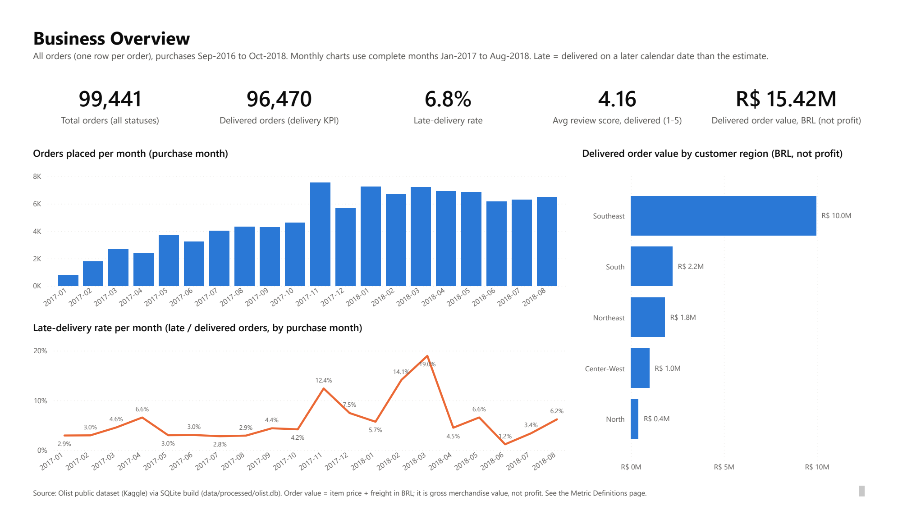
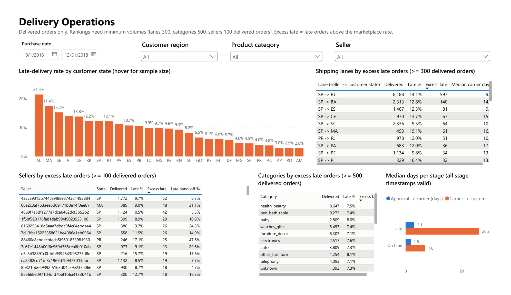
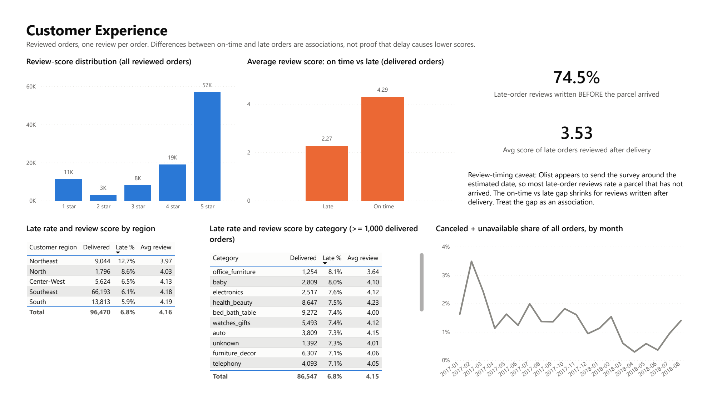

# Improving E-Commerce Delivery Performance and Customer Reviews

This project looks at about 100,000 orders from Olist, a Brazilian online marketplace, to find out where deliveries go wrong and how late deliveries relate to customer reviews. The goal was to give an operations team a short, evidence-based list of where to look first: which regions, shipping routes, sellers and product categories.

I used SQL (SQLite) to load, clean and model the data, a Jupyter notebook to check the numbers independently and explore them, and Power BI for the dashboard.

Data source: [Brazilian E-Commerce Public Dataset by Olist](https://www.kaggle.com/datasets/olistbr/brazilian-ecommerce) on Kaggle. It has 9 CSV files covering 99,441 orders placed between September 2016 and October 2018.

## What I found

1. 6.8% of delivered orders arrived after the date the customer was promised (6,534 out of 96,470). If you compare exact timestamps instead of dates the figure is 8.1%, because the promised date is stored as midnight and same-day deliveries would count as late.

2. Lateness comes in waves rather than being constant. November 2017 (Black Friday) and February to March 2018 account for 48% of all late orders. The March 2018 spike reached 19% and hit every region at once, which points to a network or carrier capacity problem rather than individual sellers.

3. The problem is concentrated in a few places. Customers in the Northeast and in Rio de Janeiro get late deliveries far more often. The single biggest contributor is the route from São Paulo sellers to Rio de Janeiro customers: 8,188 orders, 14.1% late, and roughly 597 more late orders than you would expect at the marketplace average.

4. Late orders lose their time in transit, not at the seller. For on-time orders the parcel spends a median of 7 days with the carrier. For late orders it is 26 days. The seller handover step only adds about a day.

5. Late orders get much worse reviews: an average of 2.27 stars against 4.29 for on-time orders, and 62% of them are rated 1 or 2 stars. This holds in every region and when the peak months or the biggest sellers are removed. One important caveat: about three in four reviews of late orders were written before the parcel actually arrived, so customers were often reviewing a missing package. If you only look at reviews written after delivery, the gap shrinks to 0.77 stars.

6. Product category makes little difference (late rates range from 4.3% to 8.1%). Seller rankings need care: a simple "worst late rate" list is made up entirely of sellers with fewer than 10 orders. Among sellers with at least 100 orders, 36 are worse than chance would explain.

These are observations from historical data, not proof of cause and effect. They show where to dig and what to test.

## Dashboard

The Power BI report is in [powerbi/delivery_reviews.pbix](powerbi/delivery_reviews.pbix). It has four pages: a business overview, delivery operations (with filters for date, region, category and seller), customer experience, and a page that explains every metric.







The screenshots come from Power BI's own PDF export of the report ([full PDF](reports/delivery_reviews_dashboard.pdf)). There is also a [metric definitions page](screenshots/powerbi_page4_metric_definitions.png) and a [screenshot of the report open in Power BI Desktop](screenshots/powerbi_desktop_window.png).

To make sure the dashboard and the database say the same thing, I calculated 38 key numbers inside the Power BI file and compared them with the SQL results. All 38 match exactly ([details](reports/powerbi_reconciliation.md)).

## What I would recommend testing

1. Review carrier performance on the worst routes, starting with São Paulo to Rio de Janeiro, then São Paulo to Bahia, Ceará, Maranhão and Espírito Santo. Track the late rate and transit time on each route.
2. Make delivery estimates depend on the route and the season. Promises are already about twice as long as the actual delivery time on average, but they still miss on specific routes and in peak months.
3. Agree extra carrier capacity before Black Friday and the post-holiday period, and compare peak-month late rates with normal months.
4. Set up a dispatch target for high-volume sellers who often hand parcels to the carrier after their deadline. Late handover is 3.5 times more common among late orders.
5. Send the review survey after the order is confirmed delivered, and message customers when an order is running late. Test this with an A/B split and watch review scores for late orders.

Each of these should be tested before it is rolled out. The reasoning and the metrics to track are in the [executive summary](reports/executive_summary.md).

## The questions I answered

The full SQL output for every question, with definitions and sample sizes, is in [reports/sql_results/04_business_analysis.md](reports/sql_results/04_business_analysis.md).

| Question | Short answer |
|---|---|
| What share of delivered orders were late? | 6.77% (6,534 of 96,470) |
| How does it vary by month, region, category and seller? | Spikes in Nov 2017 and Feb to Mar 2018. Northeast 12.7%, Alagoas 21.4%, Rio de Janeiro 12.1%. Categories vary little. Sellers vary a lot, but mostly in tiny samples |
| Are late deliveries linked to lower reviews? | Yes, 2.02 stars lower on average, or 0.77 lower for reviews written after delivery |
| Which sellers and categories are both large and consistently late? | 51 sellers with at least 100 orders and 6 categories, including baby, health and beauty and office furniture |
| How long does each step take? | Median: payment approval 20 minutes, handover to carrier 1.8 days, carrier to customer 7.1 days, 10.2 days in total against a 23-day promise |
| How many orders are canceled or unavailable? | 1.24% overall, between 0.3% and 3.5% depending on the month |
| Which regions bring the most orders and value? | The Southeast: 68.6% of orders and 64.6% of delivered order value |
| How do people pay? | Credit card for 75% of orders and boleto (bank slip) for 20%. Bigger orders use more instalments |
| Where should the team start? | The São Paulo to Rio de Janeiro route, then Bahia, Ceará, Espírito Santo and Maranhão customers |
| What should be tested? | The five ideas above |

## How it is built

The pipeline runs in this order:

1. Load the 9 raw CSV files into SQLite tables without changing them.
2. Check the data: row counts, data types, duplicate keys, missing links between tables, timestamps in the wrong order and status contradictions. The build stops if any check fails.
3. Build clean analysis tables in a star schema. The main table has one row per order. Items, payments and reviews are summarised to one row per order before they are joined, so no order is counted twice, and the build confirms that row counts and money totals don't change after each join.
4. Answer the business questions in SQL.
5. Recompute the headline numbers in a Jupyter notebook straight from the raw CSV files with pandas, and check they match the SQL.
6. Export the analysis tables to CSV and load them into the Power BI model.

A few definitions matter for reading the results:

- Late means the order arrived on a later calendar date than the promised date.
- Delivery metrics only use orders marked as delivered that also have a delivery date (96,470 of 99,441).
- Time between two steps is only measured when both timestamps exist and are in the right order. 1,350 orders were handed to the carrier before payment was approved, and 23 were delivered before the carrier picked them up. Those steps are left out for those orders.
- Order value is item price plus shipping, in Brazilian reais. It is not profit; the data has no cost information.

More detail is in [docs/methodology.md](docs/methodology.md) and the column-by-column [data dictionary](docs/data_dictionary.md).

## Running it yourself

You need Python 3.11 or newer. The database and notebook work on any system. The Power BI part needs Windows and Power BI Desktop.

```bash
pip install -r requirements.txt

python scripts/download_data.py      # downloads the Kaggle files into data/raw
python scripts/build_database.py     # builds data/processed/olist.db and the CSV exports (3 to 4 minutes)
python -m jupyter nbconvert --to notebook --execute --inplace notebooks/01_delivery_and_reviews.ipynb
```

If the download script doesn't work, [data/raw/README.md](data/raw/README.md) explains how to download the files by hand.

The database step only uses Python's built-in sqlite3 module, so there is no database server to install. All query results are saved to [reports/sql_results](reports/sql_results).

To use the dashboard, open `powerbi/delivery_reviews.pbix` in Power BI Desktop. The data is already inside the file. After rebuilding the database, open the report and click Home, then Refresh. If you moved the project folder, first update the DataFolder parameter (Transform data, then Edit parameters) to point at `data/processed`. [powerbi/README.md](powerbi/README.md) covers how to rebuild the report from its source files and how the numbers were checked.

## Project layout

```
data/raw/            original Kaggle CSV files (not committed, see data/raw/README.md)
data/processed/      SQLite database and CSV exports (generated, not committed)
sql/                 schema, loading and checks, transformations, business questions
scripts/             build, download and Power BI scripts
notebooks/           validation and exploration notebook
powerbi/             the .pbix report, its source files and the DAX measures
reports/             executive summary, PDF of the dashboard, query results, charts
docs/                data dictionary and methodology
screenshots/         dashboard pages
```

## Limitations

- This is historical, observational data. Late orders differ from on-time orders in other ways (region, season, seller), so the review gap is an association.
- Most reviews of late orders were written before delivery, which makes the gap look bigger than it may really be.
- The data doesn't say which carrier handled an order, so transit problems can only be traced to a route, not a company.
- 1,107 orders were still in transit when the data ends, so the last few months probably understate lateness.
- When an order has more than one seller (1.3% of orders), all its sellers share the same delivery result.
- There is no data on costs, profit, discounts, returns or customer demographics.

## Notes on the process

I first built the SQL layer in DuckDB and later moved it to SQLite. After the move, all checks were rerun and the headline numbers were compared with the earlier results. They matched, apart from one correction I found while checking Power BI against SQL: orders shipped by two sellers from the same state had been counted twice on that route. That is fixed, and the change is written up in [docs/methodology.md](docs/methodology.md).

The project's own definition of "late" is a calendar-date comparison, because the promised delivery date has no time of day. The stricter timestamp version is still reported alongside it.

Data from Olist, licensed CC BY-NC-SA 4.0. This is an independent portfolio project and is not affiliated with Olist.
