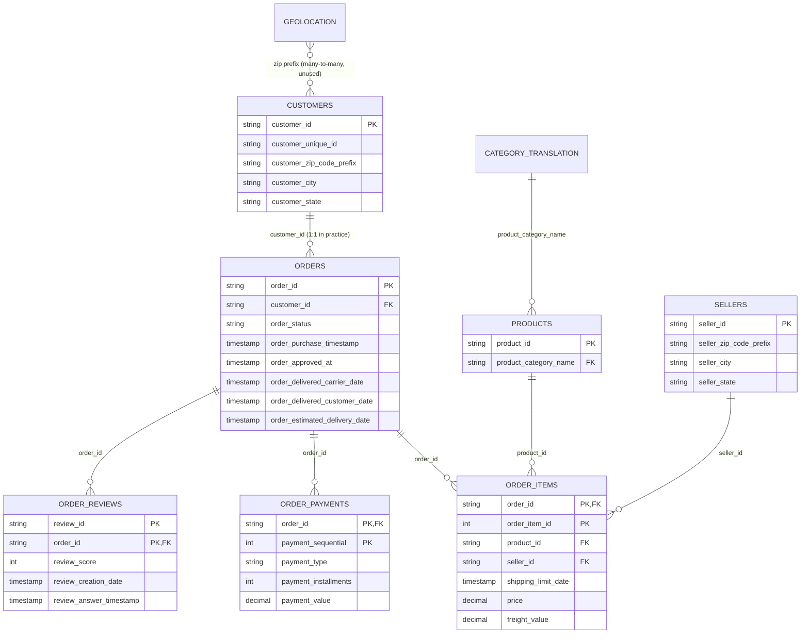

# Data dictionary

Source: [Brazilian E-Commerce Public Dataset by Olist](https://www.kaggle.com/datasets/olistbr/brazilian-ecommerce) (Kaggle, CC BY-NC-SA 4.0).
It covers about 100k orders placed on the Olist marketplace in Brazil between Sep-2016 and Oct-2018. Customer, seller and product identities are anonymised hashes.

Counts below come from the `raw_*` staging tables of the SQLite database `data/processed/olist.db` after loading. All of them are reproduced by `sql/02_load_and_validate.sql` (results in [reports/sql_results/02_load_and_validate.md](../reports/sql_results/02_load_and_validate.md)).

## 1. Raw file inventory

| File | Raw table | Rows | Grain (validated key) | Period / notes |
|---|---|---:|---|---|
| `olist_orders_dataset.csv` | `raw_orders` | 99,441 | 1 row per order (`order_id`) | purchases 2016-09-04 to 2018-10-17 |
| `olist_order_items_dataset.csv` | `raw_order_items` | 112,650 | 1 row per order item (`order_id`, `order_item_id`) | 98,666 orders have items; max 21 items per order |
| `olist_order_payments_dataset.csv` | `raw_order_payments` | 103,886 | 1 row per payment record (`order_id`, `payment_sequential`) | 99,440 orders have payments |
| `olist_order_reviews_dataset.csv` | `raw_order_reviews` | 99,224 | 1 row per (`review_id`, `order_id`). Neither column is unique alone | review created 2016-10-02 to 2018-08-31 |
| `olist_customers_dataset.csv` | `raw_customers` | 99,441 | 1 row per `customer_id` (one per order) | 96,096 distinct people (`customer_unique_id`) |
| `olist_sellers_dataset.csv` | `raw_sellers` | 3,095 | 1 row per `seller_id` | sellers in 23 states |
| `olist_products_dataset.csv` | `raw_products` | 32,951 | 1 row per `product_id` | 73 categories (Portuguese) |
| `product_category_name_translation.csv` | `raw_product_category_name_translation` | 71 | 1 row per Portuguese category | 2 used categories are missing |
| `olist_geolocation_dataset.csv` | `raw_geolocation` | 1,000,163 | not unique: many rows per zip prefix | 261,831 exact duplicate rows; not used in the model |

Fields the dataset does not contain (so no analysis claims them): product cost, margin or profit; discounts or coupons (vouchers appear only as a payment method); returns or refunds; carrier or logistics-provider identity; customer demographics (age, gender, income); marketing channel; inventory levels. Customer location is limited to zip prefix, city and state.

## 2. Schema diagram (keys and relationships)

Referential integrity was tested for every foreign key above, and there are zero orphan rows. Parent-side gaps (orders with no items, no review, and so on) are listed in section 4.

## 3. Column dictionary (raw tables)

### orders: one row per order
| Column | Type | Nulls | Description |
|---|---|---:|---|
| order_id | text | 0 | Unique order identifier |
| customer_id | text | 0 | Key to `customers`. A new customer_id is issued for every order |
| order_status | text | 0 | 8 values: delivered 96,478, shipped 1,107, canceled 625, unavailable 609, invoiced 314, processing 301, created 5, approved 2 |
| order_purchase_timestamp | timestamp | 0 | When the customer placed the order |
| order_approved_at | timestamp | 160 | When payment was approved |
| order_delivered_carrier_date | timestamp | 1,783 | When the seller handed the parcel to the logistics partner |
| order_delivered_customer_date | timestamp | 2,965 | When the customer received the parcel |
| order_estimated_delivery_date | timestamp | 0 | Delivery date promised to the customer at purchase. Always midnight: it is a date, not a time |

### order_items: one row per item in an order
| Column | Type | Nulls | Description |
|---|---|---:|---|
| order_id | text | 0 | Key to `orders` |
| order_item_id | int | 0 | Sequence number of the item within the order (1 to 21) |
| product_id | text | 0 | Key to `products` |
| seller_id | text | 0 | Key to `sellers`. An order can contain items from several sellers |
| shipping_limit_date | timestamp | 0 | Deadline for the seller to hand the item to the carrier (a few values run to 2020) |
| price | BRL | 0 | Item price (R$ 0.85 to 6,735.00) |
| freight_value | BRL | 0 | Freight charged for the item (383 items have R$ 0) |

### order_payments: one row per payment record
| Column | Type | Nulls | Description |
|---|---|---:|---|
| order_id | text | 0 | Key to `orders` |
| payment_sequential | int | 0 | Sequence when an order is paid with several methods (for example card plus vouchers) |
| payment_type | text | 0 | credit_card, boleto (Brazilian bank slip), voucher, debit_card, not_defined (3 rows) |
| payment_installments | int | 0 | Number of instalments (credit card 0 to 24; 2 rows have 0) |
| payment_value | BRL | 0 | Amount of this payment record (9 rows are R$ 0) |

### order_reviews: one row per (review, order)
| Column | Type | Nulls | Description |
|---|---|---:|---|
| review_id | text | 0 | Review identifier. Not unique (814 surplus rows) |
| order_id | text | 0 | Key to `orders`. 547 orders have 2 to 3 reviews |
| review_score | int | 0 | Satisfaction score, 1 to 5 |
| review_comment_title | text | 87,656 | Optional title (Portuguese) |
| review_comment_message | text | 58,247 | Optional free-text comment (Portuguese) |
| review_creation_date | date | 0 | Date the satisfaction survey was sent to the customer |
| review_answer_timestamp | timestamp | 0 | When the customer answered |

### customers: one row per customer_id
| Column | Type | Nulls | Description |
|---|---|---:|---|
| customer_id | text | 0 | Per-order customer key |
| customer_unique_id | text | 0 | Same person across orders (96,096 distinct) |
| customer_zip_code_prefix | text | 0 | First 5 digits of the zip code (leading zeros kept) |
| customer_city | text | 0 | City name (lower case, no accents) |
| customer_state | text | 0 | Two-letter state code (27 states incl. DF) |

### sellers: one row per seller
| Column | Type | Nulls | Description |
|---|---|---:|---|
| seller_id | text | 0 | Seller key |
| seller_zip_code_prefix | text | 0 | First 5 digits of the zip code |
| seller_city | text | 0 | City (some are dirty, e.g. a zip code typed as a city) |
| seller_state | text | 0 | State code (23 states) |

### products: one row per product
| Column | Type | Nulls | Description |
|---|---|---:|---|
| product_id | text | 0 | Product key |
| product_category_name | text | 610 | Category in Portuguese |
| product_name_lenght / product_description_lenght | int | 610 | Character length of name and description (source spelling kept) |
| product_photos_qty | int | 610 | Number of listing photos |
| product_weight_g, product_length_cm, product_height_cm, product_width_cm | int | 2 | Package weight and dimensions |

### product_category_name_translation and geolocation
`product_category_name` to `product_category_name_english` (71 rows). `geolocation` maps zip prefixes to lat/lng and city/state. Some coordinates fall outside Brazil, so it isn't used.

## 4. Known gaps and anomalies (all handled in `sql/03_transform.sql`)

| Issue | Rows | Handling |
|---|---:|---|
| Orders with no order items | 775 (603 unavailable, 164 canceled, 8 other) | Kept in `fct_orders` with `has_items = false`. These orders have no category or seller |
| Orders with no payment | 1 | Kept; payment fields NULL |
| Orders with no review | 768 | Kept; `review_score` NULL, excluded from review averages |
| Orders with more than one review | 547 | Most recently answered review kept (`stg_order_review`) |
| Products without a category | 610 | Category set to `unknown` |
| Categories missing from the translation file | 2 (`pc_gamer`, `portateis_cozinha_e_preparadores_de_alimentos`) | Translated manually and flagged in `category_translation_source` |
| `delivered` status but no delivery date | 8 | Excluded from delivery KPIs |
| `canceled` status but has a delivery date | 6 | Treated as canceled; excluded from delivery KPIs |
| Carrier hand-off before payment approval | 1,359 | Approval to carrier stage set to NULL for these orders |
| Customer delivery before carrier hand-off | 23 | Carrier to customer stage set to NULL |
| Item+freight total ≠ payment total by > R$1 | 249 orders | Both kept as separate measures (payments can include instalment interest and vouchers) |
| Geolocation exact duplicates | 261,831 | Table not used |

## 5. Analytics model (SQLite tables `fct_*`, `dim_*`, bridges)

| Table | Grain | Rows | Purpose |
|---|---|---:|---|
| `fct_orders` | 1 row per order | 99,441 | Main fact: status, timestamps, delivery flags, lifecycle durations, one review, order value, payment summary |
| `fct_order_items` | 1 row per order item | 112,650 | Item price and freight; links orders to products and sellers |
| `fct_payments` | 1 row per payment record | 103,886 | Payment method and instalment analysis |
| `order_sellers` | 1 row per (order, seller) | 100,010 | Bridge for seller-level delivery metrics |
| `order_categories` | 1 row per (order, category) | 99,470 | Bridge for category-level delivery metrics |
| `stg_order_review` | 1 row per reviewed order | 98,673 | De-duplicated reviews |
| `dim_customer` | 1 row per customer_id | 99,441 | Customer state, city and macro-region |
| `dim_seller` | 1 row per seller | 3,095 | Seller state, city and macro-region |
| `dim_product` | 1 row per product | 32,951 | English category, size and weight |
| `dim_state` | 1 row per state | 27 | State name to IBGE macro-region (reference data added by this project) |
| `dim_date` | 1 row per date | 852 | Calendar, 2016-09-01 to 2018-12-31, with `in_trend_window` flag |

SQLite storage types. IDs, codes and zip prefixes are TEXT (leading zeros kept). Timestamps are ISO-8601 TEXT `YYYY-MM-DD HH:MM:SS`, checked on load. Money is REAL (BRL). Flags (`is_*`, `has_*`, `in_trend_window`, ...) are INTEGER 1/0, with NULL = not applicable. Power BI loads the same columns from the CSV exports with explicit types (`scripts/build_powerbi_project.py`).

### Key derived columns in `fct_orders`
| Column | Definition |
|---|---|
| `status_group` | delivered / canceled / unavailable / in progress (shipped, invoiced, processing, created, approved) |
| `delivery_kpi_status`, `is_delivery_kpi_eligible` | `included` only when status = delivered and the delivery timestamp is present. Otherwise the exclusion reason |
| `is_late` | Primary: delivery calendar date > estimated delivery date. NULL when not KPI-eligible |
| `is_late_timestamp_rule` | Sensitivity: delivery timestamp > estimated timestamp (midnight) |
| `days_vs_estimate` | Delivery date − estimated date in days (negative = early) |
| `days_purchase_to_delivery` | Purchase to customer delivery, fractional days |
| `days_purchase_to_estimate` | Purchase to estimated date (the promise length) |
| `hours_purchase_to_approval` | NULL if the approval timestamp is missing or out of order |
| `days_approval_to_carrier` | NULL if the carrier date is missing or earlier than approval |
| `days_carrier_to_customer` | NULL if the delivery date is earlier than the carrier date |
| `is_lifecycle_valid` | All three stages present and in order |
| `is_carrier_handoff_late` | Carrier hand-off after the latest `shipping_limit_date` of the order's items (seller-side delay) |
| `order_value_brl` | Item price plus freight (BRL). Gross merchandise value, not revenue to Olist and not profit |
| `payment_value_brl`, `main_payment_type`, `max_installments`, `used_voucher` | Payment summary aggregated to the order |
| `review_score`, `review_count`, `review_created_before_delivery` | One review per order; flag when the survey date precedes the delivery date |
| `in_trend_window` | Purchase between 2017-01-01 and 2018-08-31 (complete months) |
